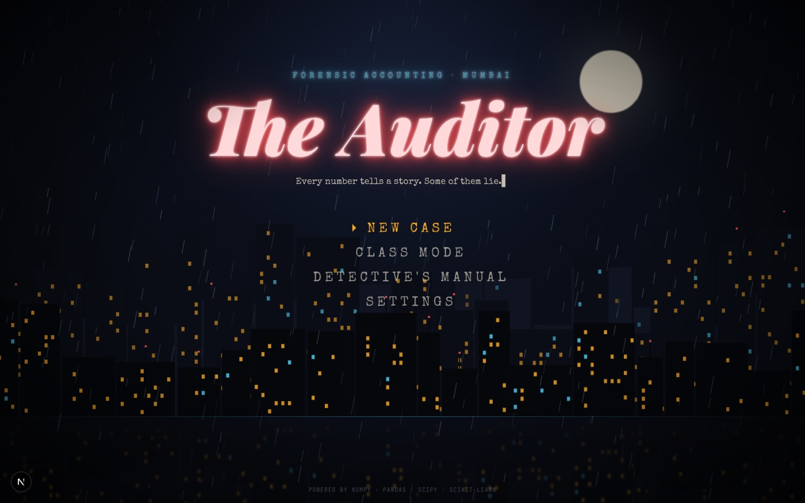
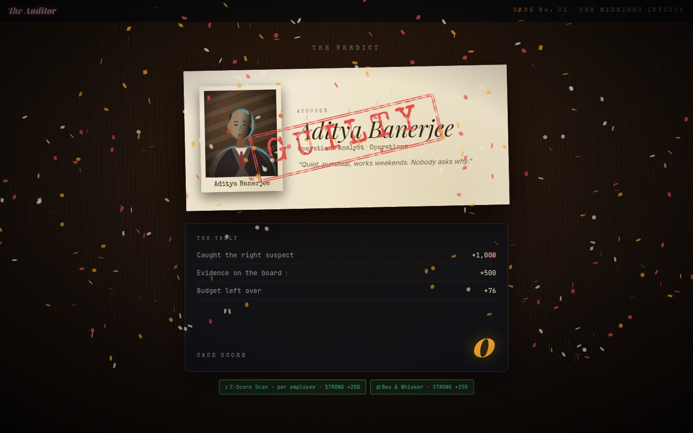
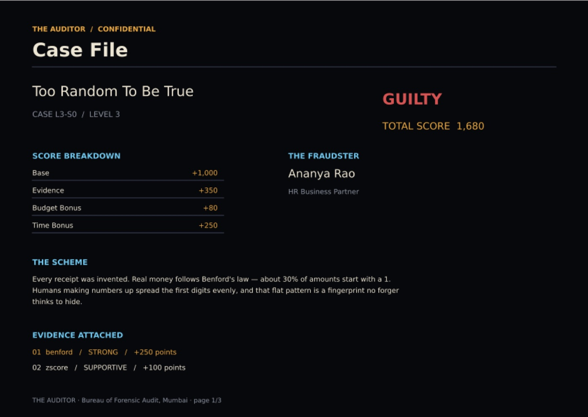

# 🕵️ OUTLIER

> *"Every number tells a story. Some of them lie."*

### ▶ Play it: **[otlr.vercel.app](https://otlr.vercel.app)**

The game runs on Vercel; the Python brain runs on a small always-on VPS (FastAPI under systemd, Caddy for HTTPS) with telemetry in Neon Postgres.

A noir detective web game where you catch corporate fraudsters with **real Python data analysis**.
Built for **IDSE (Introduction to Data Science for Engineers)**.



---

## The game in 30 seconds

Mumbai, 2 AM, monsoon. You're a rookie forensic auditor. Each case is a company ledger of about
1,000 transactions and five suspects, and one of them is cooking the books.

1. **Investigate**: run detective tools. Every tool is real pandas / scipy / scikit-learn code.
2. **Pin two clues**: drag them onto a suspect on the corkboard and tie them with red string.
3. **Accuse**: hold to accuse. One shot.
4. **Verdict**: GUILTY or WRONG SUSPECT, then the Reveal shows exactly how the fraud was hidden.

| | |
|---|---|
|  |  |
|  |  |

---

## Six cases, six techniques

| # | Case | The fraud | Caught by |
|---|---|---|---|
| 1 | The Midnight Invoice | One monster invoice | Z-scores · Tukey fences |
| 2 | Déjà Vu | The same bill, twice | Self-merge duplicate detection |
| 3 | Too Random To Be True | Invented amounts | **Benford's law** + chi-square |
| 4 | Weekend Warrior | Personal weekend spending | Binomial test on the timeline |
| 5 | The Margin Call | Padded expenses | Linear regression residuals + t-test |
| 6 | Ghost Vendor | Night payments to a fake vendor | **IsolationForest** (ML) |
| ∞ | The Adaptive Fraudster | Hides from your favourite tools | Everything |

**Red herrings** (the CEO's big but honest spending, the Diwali bonus week) teach that *an outlier is a
question, not an answer*.

**It's provably fair.** A test suite checks, over 20 random cases per level, that the right tool
catches the fraudster at least 19 times out of 20, and that honest companies are almost never accused.

---

## 💼 Career Mode: from a sweet shop to the Kaveri Inquiry

Start with offer letters from three small businesses and climb: **3 small → 5 mid → 3 large → 2 very large →
the Final**. Each contract is a year at one company: five cases, easy to hard, with the same staff and a
company "culture" that shapes its honest data. Every case gets a **0–100 rating** (verdict, evidence, tool
judgment, efficiency); the year's average decides your appraisal, your raise (₹6 LPA → ₹5 Cr) and your next
offers. Very large firms hide **two fraudsters** in one ledger. Three old colleagues follow you from your first
job, always innocent — until the Final. Full design: [game/docs/CAREER.md](game/docs/CAREER.md).

---

## 🎓 Class Mode: the class becomes the dataset

The professor puts a QR code on the projector. **The whole class joins from their phones**, races on the
same case with a live leaderboard, and then the **Class Autopsy** analyzes the class's own play data
with pandas, live.

| | |
|---|---|
|  |  |
|  |  |

- **Autopsy slides**: solve rate, tool usage, Pearson r for "does more analysis pay off?", chi-square
  for "which tool predicts success?". Each slide shows the Python that produced it.
- **Detective Cards**: KMeans groups players into four styles: Statistician, Gambler, Hacker, Visualizer.
- Tested with **200 simulated phones**: every player gets their case in about 0.13 s.

---

## 🧠 How Python powers every move

| In the game | Python |
|---|---|
| Generate a case | `numpy.random.default_rng`, log-normal spending, `pandas.DataFrame` |
| Case Summary | `groupby().describe()` |
| Pattern Matrix | `pd.crosstab` + `scipy.stats.chi2_contingency` |
| Z-Score Scan · Box & Whisker | `groupby().transform`, z-scores on log amounts, Tukey's 3·IQR fence |
| Twin Finder | self-`merge` on (employee, vendor, amount) |
| Benford's Law | first-digit counts + `scipy.stats.chisquare` |
| Timeline | `resample`, `scipy.stats.binomtest` |
| Margin Model | `sklearn.LinearRegression`, `scipy.stats.ttest_1samp` |
| Anomaly Hunter | `sklearn.ensemble.IsolationForest` |
| Charts | `plotly` figures built in Python, rendered in the browser |
| Hacker Mode | real pandas running in your browser (Pyodide) |
| Class Autopsy | SQLite telemetry → `pd.read_sql` → Pearson r, chi-square |
| Detective Cards | `StandardScaler` + `KMeans` |
| Case Report | `seaborn` + `matplotlib` PDF |

### 📓 Notebooks (the full analysis)
- [`01_case_generator.ipynb`](game/notebooks/01_case_generator.ipynb): building a believable company, and why Benford's law appears
- [`02_detection_tools.ipynb`](game/notebooks/02_detection_tools.ipynb): every tool derived by hand, plus the fairness proof
- [`03_class_autopsy.ipynb`](game/notebooks/03_class_autopsy.ipynb): telemetry, logistic regression, chi-square, KMeans + elbow/silhouette

---

## 🏗️ Architecture

```
 Browser · Next.js game UI          ◄── REST + WebSocket ──►   Python brain · FastAPI
 Tailwind · Framer Motion · Plotly                              numpy · pandas · scipy
 dnd-kit corkboard · Web Audio                                  scikit-learn · plotly · seaborn
 Pyodide (Hacker Mode)                                          SQLite telemetry → pandas
```

```
idse-course-project/
├── game/                the game (live at otlr.vercel.app)
│   ├── backend/         Python package `auditor`: case engine, 9 tools, scoring, rooms, autopsy (390+ tests)
│   ├── web/             Next.js game: title, office, investigation, corkboard, verdict, class mode
│   ├── notebooks/       the three narrated notebooks
│   └── docs/            IDEA · DESIGN · PLAN · TODO · DEMO
```

---

## 🚀 Run it

**1 · Backend** (Python 3.12 via [uv](https://docs.astral.sh/uv/))
```bash
cd game/backend
uv sync
uv run uvicorn auditor.api:app --host 0.0.0.0 --port 8000
```

**2 · Game** (Node 20+, pnpm)
```bash
cd game/web
pnpm install
pnpm dev --port 3200          # open http://localhost:3200
```

For Class Mode, phones on the same Wi-Fi join via the QR code on the host screen.

**Tests**
```bash
cd game/backend && uv run pytest              # engine, tools, fairness, API, rooms, autopsy
cd game/web && pnpm test && pnpm exec playwright test
```

---

## 📚 Docs
[IDEA](game/docs/IDEA.md) · [DESIGN](game/docs/DESIGN.md) · [CAREER](game/docs/CAREER.md) · [CAREER HANDOVER](game/docs/CAREER_HANDOVER.md) · [PLAN](game/docs/PLAN.md) · [TODO](game/docs/TODO.md) · [DEMO script](game/docs/DEMO.md)
