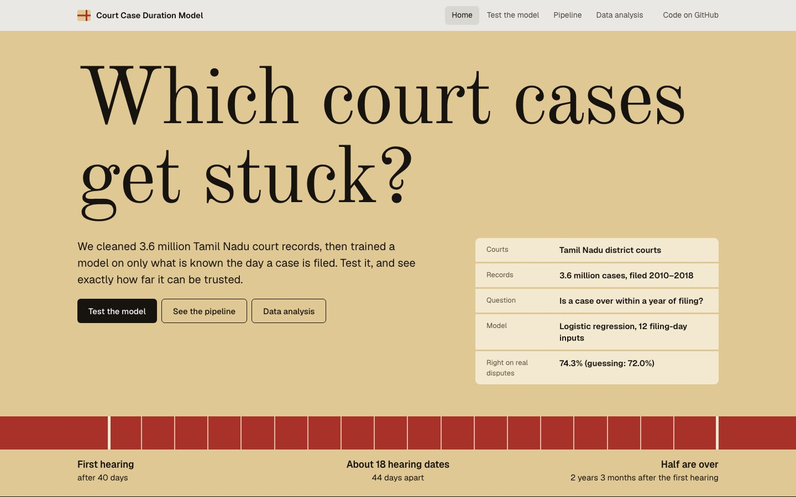
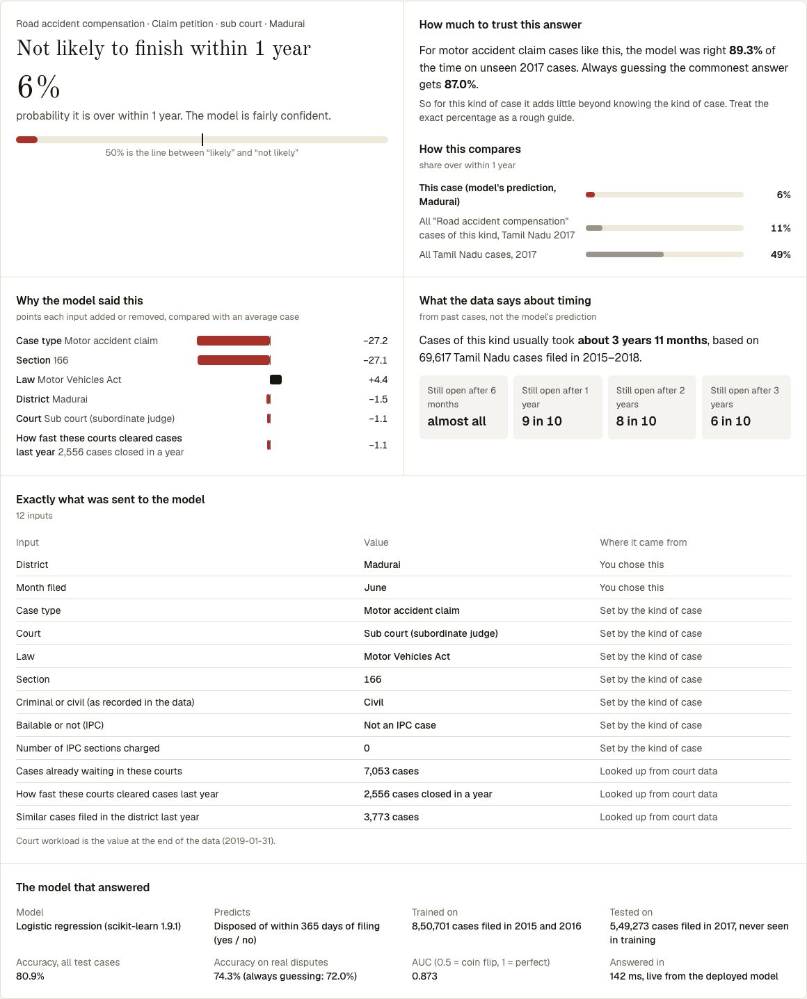
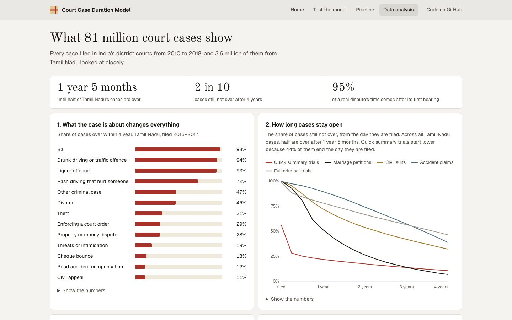
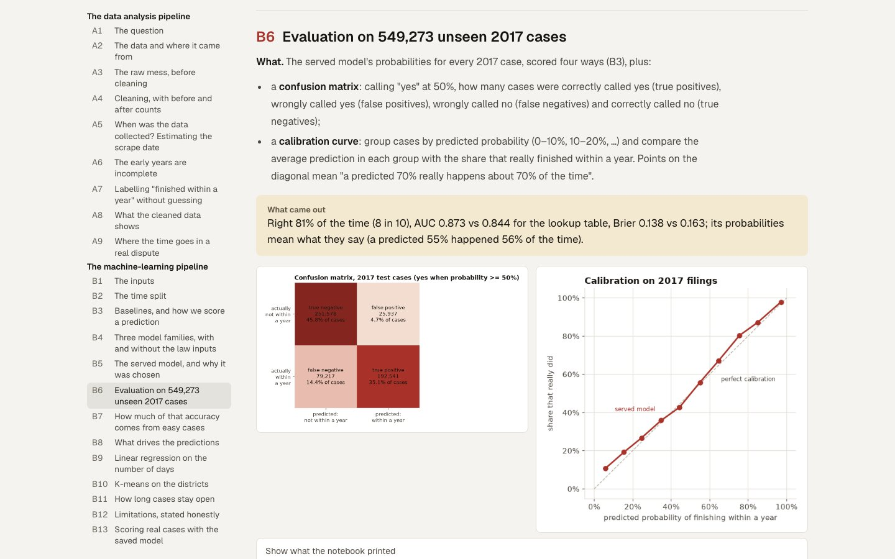
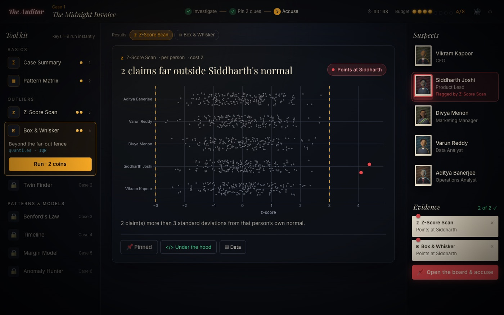
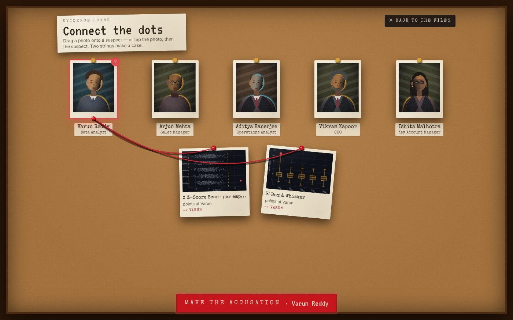
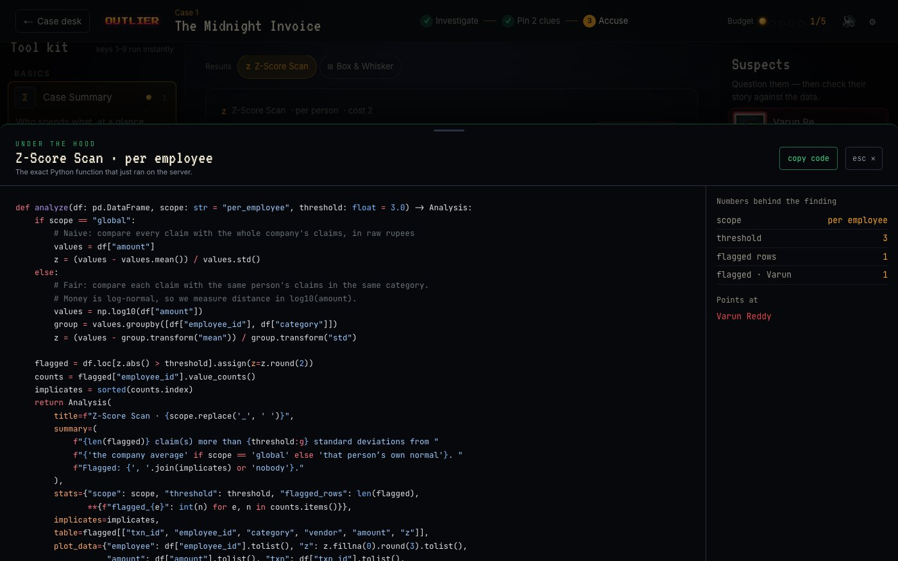
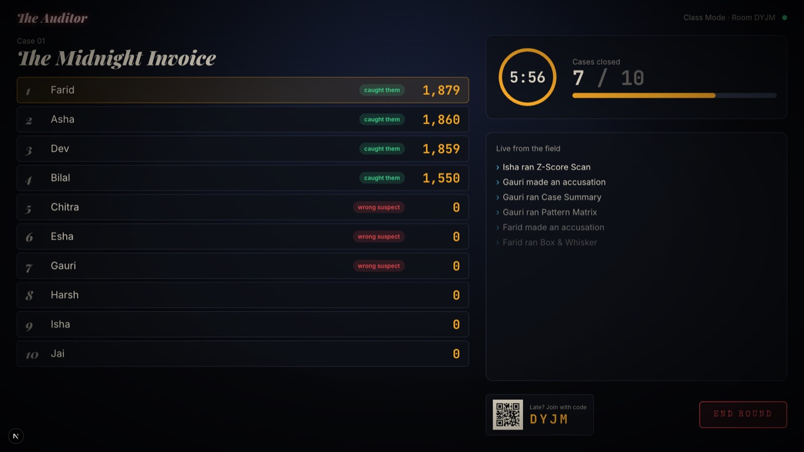
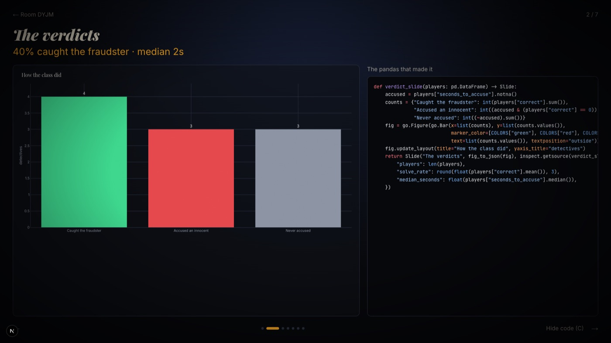
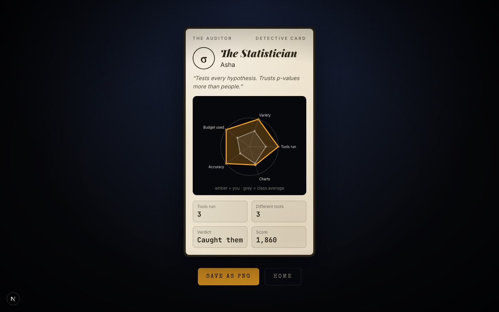

# IDSE course project · CS3006, IIITDM

Two data-science projects built for **Introduction to Data Science for Engineers**, served from one
website:

| | Live | What it is |
|---|---|---|
| 📊 **The court case duration model** | **[otlr.vercel.app/model](https://otlr.vercel.app/model)** | An end-to-end pipeline on 81 million real Indian court records: collection, cleaning, EDA, a tested model, and a site where you can try it |
| 🕵️ **OUTLIER** | **[otlr.vercel.app](https://otlr.vercel.app)** | A noir detective game where you catch corporate fraudsters with real Python data analysis |

The website runs on Vercel; the Python side (FastAPI under systemd, Caddy for HTTPS) runs on a small
always-on VPS, with game telemetry in Neon Postgres.

**Team:** Yashvanth S (CS24I1029), Jeevanandham T (CS24I1035), Nithillakrishi PY (CS24I1039).

### Quick links

| What | Where |
|---|---|
| Project report (PDF, LaTeX) | [`submission/pipeline-report/Court-Case-Duration-Report.pdf`](submission/pipeline-report/Court-Case-Duration-Report.pdf) · source [`main.tex`](submission/pipeline-report/main.tex) |
| Presentation | [`submission/Court-Case-Duration-Presentation.pptx`](submission/Court-Case-Duration-Presentation.pptx) · [PDF](submission/Court-Case-Duration-Presentation.pdf) |
| Contributions | [`submission/README.md`](submission/README.md#contributions) |
| Notebooks (pipeline) | [`00_full_pipeline`](pipeline/notebooks/00_full_pipeline.ipynb) · [`01_audit`](pipeline/notebooks/01_audit.ipynb) · [`02_eda`](pipeline/notebooks/02_eda.ipynb) · [`03_survival_and_clusters`](pipeline/notebooks/03_survival_and_clusters.ipynb) · [`04_model`](pipeline/notebooks/04_model.ipynb) |
| Notebooks (game) | [`01_case_generator`](game/notebooks/01_case_generator.ipynb) · [`02_detection_tools`](game/notebooks/02_detection_tools.ipynb) · [`03_class_autopsy`](game/notebooks/03_class_autopsy.ipynb) |
| Try the model | [otlr.vercel.app/model](https://otlr.vercel.app/model) · the pipeline step by step: [otlr.vercel.app/model/pipeline](https://otlr.vercel.app/model/pipeline) |
| Play the game | [otlr.vercel.app](https://otlr.vercel.app) · [how to play](#how-to-play) |
| Run it on your laptop | [Run it locally](#-run-it-locally) |

---

## Part 1 · The court case duration model



**The question.** Indian district courts are known for delay. *Which court cases get stuck, where,
and can you tell on the day a case is filed?* The model answers one measurable version of it: given
only what is known on filing day, **will a Tamil Nadu district-court case be disposed of within a
year?** It is a planning tool (how many new cases will still be open next year, which kinds to steer
towards mediation), not a prediction for one person's case, and not legal advice.

**The data.** [Development Data Lab](https://www.devdatalab.org/judicial-data)'s de-identified
eCourts records: **80,935,944 cases** filed 2010–2018 across India, of which **3,640,055** are from
Tamil Nadu, where IIITDM is. Licence: ODbL v1.0.

### The pipeline

| Stage | What was done |
|---|---|
| **Collect** | Streamed the 16 GB archive out of a Dropbox folder that refuses single-file links, keeping only the files needed and checking each against its CRC-32 |
| **Clean** | 29,857 hand-typed law names → 54 laws; free-text courts and sections parsed; impossible dates (year 0001, `5000-01-01`) blanked and counted; sentinel codes decoded. Every rule is tested on real strings |
| **Label honestly** | The data has no scrape date, so it was estimated per district from the collapse in monthly decisions (Jan–Feb 2019). "Within a year" is labelled only for cases watched for a full year; transfers are not counted as endings |
| **Explore** | The early years are missing their quick cases (survivorship), "median days among decided cases" is a trap, and almost all of a dispute's time comes after its first hearing. Kaplan–Meier curves, k-means on districts |
| **Model** | 12 inputs known on filing day (no hearing dates, no gender). Three baselines against logistic regression, linear SVM and random forest. Train on 2015, choose on 2016, **test once on 2017** |
| **Evaluate** | Accuracy, AUC, Brier, log loss, confusion matrix, calibration, permutation importance, drift, other horizons, and easy cases vs real disputes |
| **Deploy** | The 6 kB logistic regression is served by FastAPI; on the site you choose a case, press Analyze, and see the prediction, why, and every input it was given |

### Results on 549,273 unseen 2017 cases

| | Cases | Model accuracy | Always guessing the commonest answer | AUC |
|---|---|---|---|---|
| All cases | 549,273 | 80.9% | 50.5% | 0.873 |
| Easy cases (petty summary trials, bail-type petitions) | 196,105 | 92.6% | 88.1% | 0.903 |
| **Real disputes** | **353,168** | **74.3%** | **72.0%** | **0.706** |

The served model beats a case type × district lookup table (AUC 0.873 vs 0.844, Brier 0.138 vs
0.163) and its probabilities are calibrated (a predicted 55% happens 56% of the time). But most of
that accuracy is easy cases. **On real disputes, filing-day information barely beats guessing**, and
models trained only on disputes do no better: the limit is the information, not the algorithm.

### What we found

- **The kind of case decides most.** Bail cases are over within a year 98% of the time; civil appeals 11%.
- **The time comes after the start.** A typical dispute waits 40 days for its first hearing, then runs
  another 2 years 3 months: 95% of its time comes after the first hearing.
- **Cheque-bounce cases settle far more often.** Inside magistrate trials, 9.9% of cheque-bounce cases
  settle within two years, against 0.7% of Indian Penal Code cases. That is where a legal-aid office
  could steer cases to mediation.
- **Some states have huge backlogs.** Of the cases filed in 2010, 63% in Bihar were still open in
  early 2019; in Tamil Nadu, 10%.

| | |
|---|---|
|  |  |
| **Test the model:** the prediction, how much to trust it, why, and the 12 inputs sent | **Data analysis:** what 81 million cases show |



**Read more**

- [`pipeline/REPORT.md`](pipeline/REPORT.md): the write-up, stage by stage, with every number.
- [`pipeline/notebooks/00_full_pipeline.ipynb`](pipeline/notebooks/00_full_pipeline.ipynb): the whole
  pipeline in one executed notebook, also readable at
  [otlr.vercel.app/model/pipeline](https://otlr.vercel.app/model/pipeline); plus four focused
  notebooks: audit, EDA, survival and clusters, model.
- [`pipeline/README.md`](pipeline/README.md): how to run every step, the raw facts measured, and each
  decision with its reason.

---

## Part 2 · OUTLIER, the game

> *"Every number tells a story. Some of them lie."*

A noir detective web game where you catch corporate fraudsters with **real Python data analysis**.
Play it at **[otlr.vercel.app](https://otlr.vercel.app)**.


---

### The game in 30 seconds

Mumbai, 2 AM, monsoon. You're a rookie forensic auditor. Each case is a company ledger of about
1,000 transactions and five suspects, and one of them is cooking the books.

1. **Investigate**: run detective tools. Every tool is real pandas / scipy / scikit-learn code.
2. **Pin two clues**: drag them onto a suspect on the corkboard and tie them with red string.
3. **Accuse**: hold to accuse. One shot.
4. **Verdict**: GUILTY or WRONG SUSPECT, then the Reveal shows exactly how the fraud was hidden.

### How to play

Open **[otlr.vercel.app](https://otlr.vercel.app)** on a laptop or phone (no sign-up).

**Quick Case (solo, start here)**
1. Choose **QUICK CASE**. The case desk opens; case 1 is unlocked, and solving a case unlocks the next.
2. Read the briefing memo: the company, the five suspects and your **coin budget**. Every tool costs
   coins and the budget never covers all of them, so choose. Each coin left over is worth 40 points.
3. Run tools from the tool kit (or press keys 1–9). Each result says who it points at; open
   **Under the hood** to see the exact Python that ran. You can also question suspects.
4. Click **Pin as evidence** on the two results you trust most.
5. Press **B** (or *Open the board & accuse*), drag both clues onto one suspect, then press
   **MAKE THE ACCUSATION** and hold the button until it fills.
6. The verdict shows your score, and the Reveal shows how the fraud was hidden and which tool catches it.

**Career Mode:** choose **CAREER**, pick one of three small companies and work your way up to the
Final. Here an accusation also needs the trick you think was used and 1–5 rows from the ledger as
exhibits; each case is rated out of 100 ([details](game/docs/CAREER.md)).

**Class Mode (for a lecture):** the teacher opens **CLASS MODE** on the projector to create a room.
Students scan the QR code (or open the link and type the room code) and play the same case on their
phones while a live leaderboard runs. After the round, the **Class Autopsy** analyses the class's own
play with pandas. It works on the live site; to host it from your own laptop instead, see
[Run it locally](#-run-it-locally).

**Hacker Mode:** write your own pandas query against the ledger in the browser (Python runs in
Pyodide); it costs 1 coin a run.

| | |
|---|---|
|  |  |
|  |  |

---

### Six cases, six techniques

| # | Case | The fraud | Caught by |
|---|---|---|---|
| 1 | The Midnight Invoice | One monster invoice | Z-scores · Tukey fences |
| 2 | Déjà Vu | The same bill, twice | Self-merge duplicate detection |
| 3 | Too Random To Be True | Invented amounts | **Benford's law** + chi-square |
| 4 | Weekend Warrior | Personal weekend spending | Binomial test on the timeline |
| 5 | The Margin Call | Padded expenses | Linear regression residuals + t-test |
| 6 | Ghost Vendor | Night payments to a fake vendor | **IsolationForest** (ML) |
| ∞ | The Adaptive Fraudster | Hides from your favourite tools | Everything |

**Red herrings** (the CEO's big but honest spending, the Diwali bonus week) teach that *an outlier is a
question, not an answer*.

**It's provably fair.** A test suite checks, over 20 random cases per level, that the right tool
catches the fraudster at least 19 times out of 20, and that honest companies are almost never accused.

---

### 💼 Career Mode: from a sweet shop to the Kaveri Inquiry

Start with offer letters from three small businesses and climb: **3 small → 5 mid → 3 large → 2 very large →
the Final**. Each contract is a year at one company: five cases, easy to hard, with the same staff and a
company "culture" that shapes its honest data. Every case gets a **0–100 rating** (verdict, evidence, tool
judgment, efficiency); the year's average decides your appraisal, your raise (₹6 LPA → ₹5 Cr) and your next
offers. Very large firms hide **two fraudsters** in one ledger. Three old colleagues follow you from your first
job, always innocent — until the Final. Full design: [game/docs/CAREER.md](game/docs/CAREER.md).

---

### 🎓 Class Mode: the class becomes the dataset

The professor puts a QR code on the projector. **The whole class joins from their phones**, races on the
same case with a live leaderboard, and then the **Class Autopsy** analyzes the class's own play data
with pandas, live.

| | |
|---|---|
|  |  |
|  |  |

- **Autopsy slides**: solve rate, tool usage, Pearson r for "does more analysis pay off?", Fisher's
  exact test for "which tool predicts success?". Each slide shows the Python that produced it.
- **Detective Cards**: KMeans groups players into four styles: Statistician, Gambler, Hacker, Visualizer.
- Tested with **200 simulated phones**: every player gets their case in about 0.13 s.

---

### 🧠 How Python powers every move

| In the game | Python |
|---|---|
| Generate a case | `numpy.random.default_rng`, log-normal spending, `pandas.DataFrame` |
| Case Summary | `groupby().describe()` |
| Pattern Matrix | `pd.crosstab` + `scipy.stats.chi2_contingency` |
| Z-Score Scan · Box & Whisker | `groupby().transform`, z-scores on log amounts, Tukey's 3·IQR fence |
| Twin Finder | self-`merge` on (employee, vendor, amount) |
| Benford's Law | first-digit counts + `scipy.stats.chisquare` |
| Timeline | `resample`, `scipy.stats.binomtest` |
| Margin Model | `sklearn.LinearRegression`, `scipy.stats.ttest_1samp` |
| Anomaly Hunter | `sklearn.ensemble.IsolationForest` |
| Charts | `plotly` figures built in Python, rendered in the browser |
| Hacker Mode | real pandas running in your browser (Pyodide) |
| Class Autopsy | SQLite telemetry → `pd.read_sql` → Pearson r, Fisher's exact test |
| Detective Cards | `StandardScaler` + `KMeans` |
| Case Report | `seaborn` + `matplotlib` PDF |

#### 📓 Notebooks (the full analysis)
- [`01_case_generator.ipynb`](game/notebooks/01_case_generator.ipynb): building a believable company, and why Benford's law appears
- [`02_detection_tools.ipynb`](game/notebooks/02_detection_tools.ipynb): every tool derived by hand, plus the fairness proof
- [`03_class_autopsy.ipynb`](game/notebooks/03_class_autopsy.ipynb): telemetry, logistic regression, chi-square, KMeans + elbow/silhouette

---

## 🏗️ Architecture

```
 Browser · Next.js on Vercel             ◄── REST + WebSocket ──►   Python · FastAPI on a VPS
 /         the game                                                  auditor/              the game engine
 /model    the court case model site    ── /model-api/* proxy ──►   auditor/court_model/  the served model
 Tailwind · Framer Motion · Plotly                                   numpy · pandas · scipy · scikit-learn
 dnd-kit corkboard · Pyodide (Hacker Mode)                           telemetry → Neon Postgres → pandas
```

The model site calls the API through its own domain (`/model-api/*` is rewritten to the VPS), so a
visitor only ever talks to Vercel.

```
idse-course-project/
├── pipeline/            the court case duration model (served at /model)
│   ├── src/courtcases/  cleaning, labelling, features, survival, clustering, settlement (142 tests)
│   ├── scripts/         download → parquet → labels → models → reports → site package → notebook page
│   ├── notebooks/       00 the full pipeline · 01 audit · 02 EDA · 03 survival and clusters · 04 model
│   ├── reports/         generated tables, JSON and figures
│   └── REPORT.md        the write-up
├── submission/          the course submission: report (LaTeX + PDF), presentation, contributions
├── game/
│   ├── backend/         Python package `auditor`: case engine, 9 tools, scoring, rooms, autopsy, the /model API (400 tests)
│   ├── web/             Next.js: the game and the /model site
│   ├── notebooks/       the game's three narrated notebooks
│   └── docs/            IDEA · DESIGN · CAREER · TODO · DEMO
└── README.md            this file
```

---

## 🚀 Run it locally

**1 · Backend** (Python 3.12 via [uv](https://docs.astral.sh/uv/)): serves the game and `/api/model/*`
```bash
cd game/backend
uv sync
uv run uvicorn auditor.api:app --host 0.0.0.0 --port 8000
```

**2 · Website** (Node 20+, pnpm)
```bash
cd game/web
pnpm install
pnpm dev --port 3200          # the game at http://localhost:3200, the model at /model
```

For Class Mode, phones on the same Wi-Fi join via the QR code on the host screen.

**3 · The pipeline** (only needed to rebuild the model from the raw data; about an hour, mostly the download)
```bash
cd pipeline
uv sync
uv run pytest                 # then follow pipeline/README.md, "Run it"
```

**Tests**
```bash
cd pipeline && uv run pytest                  # 142: cleaning rules on real strings, labels, cutoff, survival, settlement
cd game/backend && uv run pytest              # 400: engine, tools, fairness, API, rooms, autopsy, the /model API
cd game/web && pnpm test && pnpm e2e          # unit tests, then Playwright end to end (needs the backend running)
```

---

## 📚 Docs and credits

- Model: [REPORT](pipeline/REPORT.md) · [pipeline README](pipeline/README.md) · [notebooks](pipeline/notebooks/)
- Game: [IDEA](game/docs/IDEA.md) · [DESIGN](game/docs/DESIGN.md) · [CAREER](game/docs/CAREER.md) · [TODO](game/docs/TODO.md) · [DEMO script](game/docs/DEMO.md)
- Contains data from Development Data Lab's judicial data, ODbL v1.0. Photograph on the model site:
  Madras High Court by Yercaud-elango, CC BY 4.0, via Wikimedia Commons.
